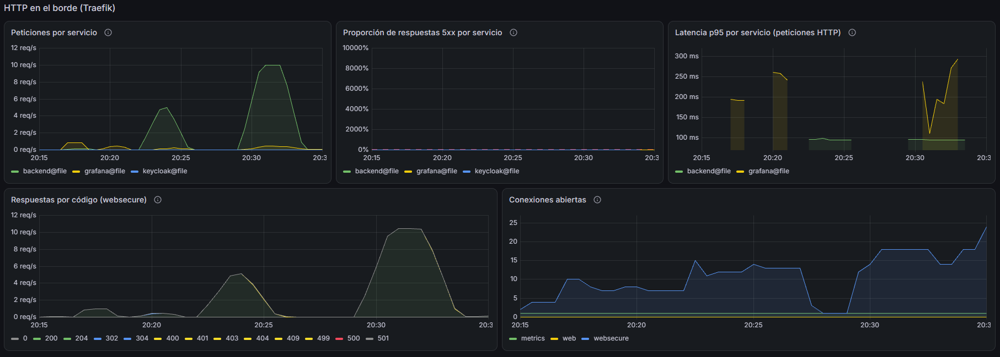
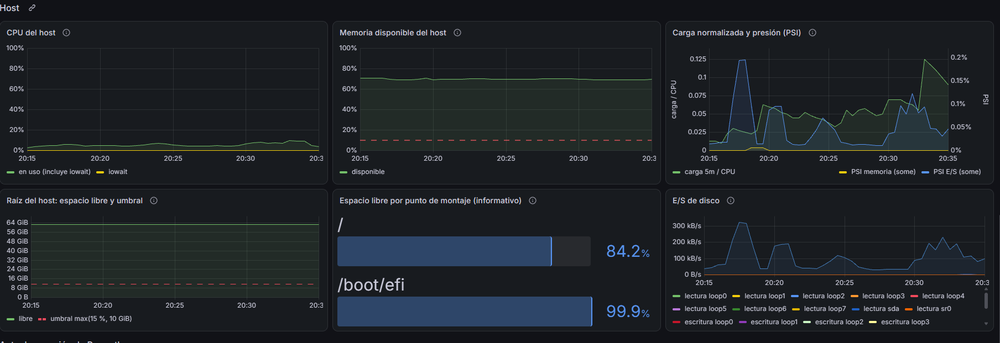

# Evaluación de carga S1 en staging (2026-11-08)

## Objetivo y escenario evaluado

Se midió el comportamiento de la consulta de disponibilidad de cupos de un médico bajo una tasa de
llegadas controlada:

```
GET /api/doctor/{doctorId}/available-slots?date=YYYY-MM-DD
```

Es una consulta autenticada y de solo lectura. El flujo de agendamiento del frontend la usa para
mostrar las horas libres de un médico en una fecha (escenario **S1** del arnés de
[`loadtests/`](../../loadtests/README.md)).

La prueba se hizo contra el entorno de staging integrado, a través de la misma ruta pública que usa
el frontend: Cloudflare → Traefik → backend → PostgreSQL. Así, una misma ventana de tiempo muestra
a la vez:

- lo que percibe un cliente externo: latencia, tasa lograda y errores;
- lo que hacen el proxy, la aplicación, la JVM, el pool de conexiones y el host, con la pila de
  observabilidad ya desplegada ([Métricas](../operations/runbooks/metricas.md)).

**Alcance.** Una sola operación de lectura, con un conjunto de datos sintético controlado y etapas
de hasta 180 s.

**Fuera de alcance.** No se evaluaron otras operaciones, como el listado o la creación de citas. La
prueba no buscó la capacidad máxima.

## Entorno y método

| Elemento | Valor |
|---|---|
| Fecha | 2026-11-08, de 01:16:53 a 01:32:04 UTC (2026-11-07, de 20:16 a 20:32, hora de Colombia, UTC−5) |
| Arnés | `loadtests/` en `59ce3e92`; k6 `grafana/k6:2.2.0@sha256:9bd01d6941fca969cb61bb57d2da5ee9b385fe2aa8881df3798c196564d6ace6` |
| Backend | `ghcr.io/jm-ortega/piedrazul-agendamiento-citas/backend@sha256:4474be53ac80d87909d2ae823636b5f4520a5cff45ef071ef4510d1933daa124`, construido desde `d6b28c26`, con el perfil de Spring `prod`. El host evaluado es de staging: el perfil `prod` describe la configuración de la aplicación, no un despliegue de producción |
| Host | Servidor de staging en Hetzner (región Helsinki), ~4 vCPU y 7,6 GiB de RAM, sin swap. Comparte el host con PostgreSQL, Keycloak, Traefik y la pila de observabilidad |
| Generador | k6 en Docker sobre WSL2, en un equipo fuera de Hetzner ubicado en Colombia (según el responsable de la prueba) |
| Ruta | `https://api.piedrazul.org`, a través de Cloudflare (proxy) y Traefik (TLS de origen) hasta el backend |
| Datos | Fixture sintético: un médico con agenda los lunes y martes de 06:10 a 07:00 cada 20 min. El descubrimiento del arnés encontró 3 pares médico/fecha con cupos (2026-11-09, 2026-11-10 y 2026-11-17) |
| Identidad | Un usuario sintético con rol `SCHEDULER` y un único access token. Solo se hicieron consultas `GET` permitidas a ese rol |

### Etapas

Las etapas se ejecutaron en orden, con 5 minutos de separación:

| Etapa | Ejecutor k6 | Configuración |
|---|---|---|
| Smoke | `per-vu-iterations` | 1 VU, 10 iteraciones. Comprobación funcional secuencial, no es una carga sostenida |
| Carga 5/s | `constant-arrival-rate` | 5 llegadas/s durante 120 s; `preAllocatedVUs` 10, `maxVUs` 25 |
| Carga 10/s | `constant-arrival-rate` | 10 llegadas/s durante 180 s; `preAllocatedVUs` 20, `maxVUs` 50 |

### Funcionamiento del arnés

- **Setup.** En cada etapa consulta los médicos disponibles y sondea los cupos de cada fecha
  candidata. Son 4 solicitudes por etapa, que llevan su propia etiqueta y no cuentan en las métricas
  S1.
- **Criterio de éxito.** Una solicitud S1 es correcta solo si responde 200 con una lista no vacía de
  horas.
- **Umbrales.** Son solo funcionales: `s1_ok` = 100 %, `http_req_failed` = 0 y, en las cargas,
  `dropped_iterations` = 0.
- **Más detalle.** Ejecución, perfiles, estados del resultado y manejo del token están en
  [`loadtests/README.md`](../../loadtests/README.md).

### Salvaguardas

Durante toda la secuencia, un muestreo de solo lectura en el host (cada ~12 s) podía detener k6 si
detectaba alguna de estas condiciones:

- reinicio o cambio de un contenedor;
- memoria disponible < 1,5 GiB;
- Keycloak > 900 MiB;
- presión de CPU > 50 % durante 30 s;
- un target de Prometheus caído o una alerta disparada;
- respuestas 5xx, 401, 403 o 429 en Traefik;
- tasa en Traefik inferior a la mitad de la pedida.

No se activó ninguna.

## Mediciones y comportamiento observado

### Cliente (k6)

Los valores provienen de los tres `result.json` originales, versionados en
[`carga-s1-staging-2026-11-08/k6/`](carga-s1-staging-2026-11-08/k6/). Solo cuentan solicitudes S1,
sin el setup. Latencias en ms.

| | Smoke | Carga 5/s | Carga 10/s |
|---|---:|---:|---:|
| Archivo | [`…011653Z-smoke`](carga-s1-staging-2026-11-08/k6/20261108T011653Z-smoke.result.json) | [`…012158Z-load`](carga-s1-staging-2026-11-08/k6/20261108T012158Z-load.result.json) | [`…012901Z-load`](carga-s1-staging-2026-11-08/k6/20261108T012901Z-load.result.json) |
| Tasa configurada | — (1 VU secuencial) | 5/s × 120 s | 10/s × 180 s |
| Solicitudes previstas / generadas | 10 / 10 | 600 / 601 | 1800 / 1801 |
| Tasa lograda (`s1_rate_per_s`) | — | 5,01/s | 10,01/s |
| `dropped_iterations` | 0 | 0 | 0 |
| VUs activos máximos (`max_vus_active`) | 1 | 4 | 7 |
| Media | 229,13 | 219,69 | 212,91 |
| Mínimo | 212,78 | 204,37 | 201,78 |
| p50 | 229,97 | 211,98 | 208,91 |
| p90 | 237,72 | 229,84 | 222,08 |
| p95 | 237,94 | 233,61 | 228,81 |
| p99 | 238,11 | 359,98 | 240,93 |
| Máximo | 238,16 | 657,25 | 695,73 |
| Fallos HTTP / errores funcionales | 0 / 0 | 0 / 0 | 0 / 0 |
| `status` | `passed` | `passed` | `passed` |

En total se midieron **2412 solicitudes S1**: 10 de smoke, 601 a 5/s y 1801 a 10/s. Todas
respondieron 200 con una lista válida de horas. Solo las dos últimas etapas son cargas de tasa
sostenida.

En las cargas, k6 registró una solicitud más que las previstas (601 y 1801). Los VUs activos son
ejecuciones concurrentes que k6 necesitó para sostener la tasa: no son usuarios simultáneos.

### Servidor

Valores de Prometheus (scrape cada 30 s) y del muestreo del host, sobre la ventana de cada carga:
01:21:59–01:24:00 UTC para 5/s y 01:29:02–01:32:04 UTC para 10/s. La columna *Tipo* indica cómo se
obtuvo cada valor:

- *muestra*: valor de un gauge en los scrapes;
- *estimación*: resultado de `rate`, `increase` o una razón suma/conteo;
- *directo*: lectura de `docker` o `/proc`.

Estos datos se conservan fuera del repositorio (ver
[Procedencia](#conclusiones-aplicabilidad-y-procedencia)).

| Observación | Carga 5/s | Carga 10/s | Tipo |
|---|---|---|---|
| Respuestas de S1 en el backend y en Traefik (`backend@file`) | solo 200 | solo 200 | estimación (`increase`); los conteos (~605 y ~1821) extrapolan y no sustituyen los de k6 |
| Latencia media de S1 en el backend | 5,1 ms | 3,7 ms | estimación |
| Máximo muestreado de S1 en el backend (`http_server_requests_seconds_max`) | 14,7 ms | 19,7 ms | muestra (máximo de las muestras de un gauge, no de todas las solicitudes) |
| Latencia media en Traefik hacia el backend | 5,6 ms | 4,4 ms | estimación |
| CPU del host ocupada, media / máxima | 6,2 % / 7,2 % | 7,1 % / 8,6 % | estimación (`rate` de `node_cpu_seconds_total`) |
| CPU del proceso backend (fracción del host), media / máxima | 1,2 % / 2,1 % | 1,7 % / 3,3 % | muestra |
| Memoria disponible del host, mínima | 5,27 GiB | 5,23 GiB | muestra |
| Presión de memoria (PSI) | 0 | 0 | estimación |
| Heap del backend usado, máximo (máx. configurado ≈ 6,1 GB) | 167 MB | 154 MB | muestra |
| Pausas de GC (G1 Young): cantidad / tiempo total / máxima | ≈1 / 12 ms / 9 ms | ≈4 / 28 ms / 12 ms | estimación; la máxima es muestra |
| HikariCP: activas / ociosas / en espera en cada scrape | 0 / 10 / 0 | 0 / 10 / 0 | muestra |
| HikariCP: timeouts, adquisición media, uso medio de la conexión | 0, 29 µs, 2,4 ms | 0, 21 µs, 1,4 ms | estimación |
| Keycloak: heap máximo / memoria del contenedor (límite 1 GiB) | 126 MB / ≤ 590 MiB | 177 MB / ≤ 590 MiB | muestra / directo |
| Targets de Prometheus | 8/8 `up` | 8/8 `up` | muestra |
| Alertas (`ALERTS`, pending o firing) | ninguna | ninguna | muestra |
| Reinicios, OOM kills | 0, 0 | 0, 0 | `changes(process_start_time_seconds)`, `node_vmstat_oom_kill`, `docker inspect` |

Tres precisiones sobre la tabla:

- **HikariCP.** Las 0 conexiones activas en cada scrape son instantáneas. El uso medio de 1–2 ms
  muestra que S1 sí usa el pool; lo que no hubo fue espera.
- **Logs.** Entre 01:15 y 01:34 UTC, Loki no registró líneas del backend ni de Keycloak en ningún
  nivel, y sí 6 líneas `info` de PostgreSQL. Esto no prueba que no hubiera fallos de otro tipo.
- **Tráfico ajeno a S1.** La pila registró, en la misma ventana, tráfico de una sesión interactiva
  de Grafana, incluidas cancelaciones de navegador (`499`).



*Figura 1. Panel "HTTP en el borde (Traefik)" del dashboard Plataforma, entre las 20:15 y las 20:35
del 2026-11-07, hora de Colombia (01:15–01:35 UTC).*

- **Peticiones por servicio** (en verde, `backend@file`) muestra las dos mesetas de carga, de ~5 y
  ~10 solicitudes/s; las curvas llegan y se retiran con el retraso de la ventana de `rate()`.
- **Proporción de respuestas 5xx** se mantiene en 0 %.
- La serie amarilla es tráfico de Grafana, no de S1.
- El panel **Latencia p95 por servicio** marca para el backend el borde del primer bucket de Traefik
  (100 ms), no un percentil medido (ver [Interpretación](#interpretación-técnica)).



*Figura 2. Sección "Host" del dashboard Plataforma, en la misma ventana.*

- **CPU del host:** se mantiene por debajo del 10 %, con un aumento leve durante la carga de 10/s.
- **Memoria disponible:** estable, alrededor del 70 %.
- **Carga normalizada y presión (PSI):** el eje derecho está en décimas de punto porcentual, así
  que los valores son despreciables.
- **Espacio en disco y E/S:** sin presión.

## Interpretación técnica

1. **Corrección y tasa sostenida.**
   - Las dos cargas sostuvieron la tasa configurada (5,01/s y 10,01/s) sin iteraciones perdidas.
   - k6 necesitó a lo sumo 7 VUs simultáneos.
   - Todas las respuestas fueron correctas.
2. **Sin degradación observable de 5/s a 10/s.**
   - Al duplicar la tasa, el p95 del cliente no empeoró (233,61 → 228,81 ms).
   - Los indicadores del servidor siguieron en valores bajos: latencia media de pocos milisegundos,
     CPU por debajo del 10 %, pool de conexiones sin espera, pausas de GC de pocos milisegundos y sin
     reinicios ni alertas.
   - Las diferencias entre ambas etapas son pequeñas y no implican que más carga mejore la latencia.
   - Tampoco permiten estimar dónde estaría el límite.
3. **Qué mide la latencia del cliente.**
   - En k6, `http_req_duration = http_req_sending + http_req_waiting + http_req_receiving`.
   - Excluye la resolución DNS, el establecimiento TCP, el handshake TLS y el tiempo bloqueado, que
     k6 mide por separado. Eso no significa que todas las solicitudes reutilizaran una conexión.
   - Casi todo el tiempo es espera hasta el primer byte: unos 209 ms de mediana a 10/s.
4. **Cliente frente a servidor.**
   - El p95 del cliente (228,81 ms) y la media del backend (~3,7 ms) o de Traefik (~4,4 ms) son
     medidas distintas, tomadas en puntos distintos y con estadísticos distintos.
   - Restarlas no da una latencia de red.
   - Lo que sí muestran es que el procesamiento en el backend y el proxy es una fracción pequeña del
     tiempo que percibe el cliente.
   - El tránsito intercontinental (Colombia → Helsinki) y el procesamiento en Cloudflare son
     contribuyentes plausibles del resto. No se midió el aporte de cada uno.
5. **Valores atípicos sin explicar.**
   - El p99 de la carga de 5/s (359,98 ms) y los máximos de 657,25 y 695,73 ms no tienen
     contrapartida en el servidor en las mismas ventanas: el máximo muestreado del backend fue
     ≤ 20 ms, y en Traefik todas las solicitudes cayeron en el bucket de ≤ 100 ms.
   - Su causa no quedó determinada.
6. **Percentiles del servidor.**
   - Todas las solicitudes S1 cayeron en el primer bucket de los histogramas: 50 ms en el backend y
     100 ms en Traefik.
   - Los p95 que dibuja Grafana (~47,5–49,5 ms y ~95–100 ms) son interpolaciones dentro de ese
     bucket, no percentiles medidos.
   - Por eso, del lado del servidor se informan medias y máximos muestreados. La explicación de los
     buckets está en [Métricas → Alertas](../operations/runbooks/metricas.md#alertas).
7. **Antecedente local.**
   - El 2026-10-28 se ejecutó el mismo escenario (10/s durante 180 s) con una versión previa del
     arnés (`6f629c8c`, con cambios sin confirmar), contra un backend de desarrollo en el mismo
     equipo, por HTTP local, con otros datos (2 médicos, 6 pares).
   - Generó 1801 solicitudes a 10,01/s, sin fallos ni iteraciones perdidas, con un p95 del cliente
     de 10,66 ms.
   - Muestra que el arnés y el endpoint sostenían esa configuración. No es una línea base de staging.
   - Los entornos y rutas distintos impiden una comparación directa de rendimiento. La evidencia no
     establece una regresión del backend ni cuantifica el aporte de la red o del borde.
   - Sus resultados no están versionados.

## Conclusiones, aplicabilidad y procedencia

### Qué demuestra la evaluación

En las condiciones evaluadas:

- La consulta de cupos disponibles, desplegada en la revisión indicada y alcanzada por la ruta
  pública completa, respondió correctamente el 100 % de 2412 solicitudes autenticadas.
- Sostuvo 5 y 10 solicitudes/s sin iteraciones perdidas.
- La latencia del cliente fue estable, con un p95 de 229–234 ms en las cargas.
- El backend procesó cada solicitud en pocos milisegundos de media.
- Ningún recurso observado (CPU, memoria, GC, pool de conexiones, Keycloak) mostró presión.
- No hubo reinicios, OOM ni alertas.
- La pila de observabilidad permitió correlacionar cliente, proxy, aplicación y host en las mismas
  ventanas.

### Qué no demuestra

- La capacidad máxima ni un límite de saturación.
- El comportamiento de otras operaciones, de escrituras (creación de citas) o de contención entre
  reservas concurrentes.
- El comportamiento con volúmenes de datos o patrones de uso reales: el fixture tenía un médico y 3
  pares médico/fecha recorridos en ronda, un único usuario y un único token.
- Un acuerdo de nivel de servicio clínico ni la preparación para producción.
- El reparto preciso de la latencia del cliente entre red, Cloudflare y origen.

### Reproducción

La revisión evaluada del arnés es `59ce3e92`. La evaluación usó cupos de las fechas 2026-11-09,
2026-11-10 y 2026-11-17. Una nueva corrida requiere:

- un fixture sintético con cupos disponibles y vigentes en el momento de ejecutarla;
- credenciales de prueba apropiadas: un access token vigente de un usuario sintético con rol
  `SCHEDULER`;
- la autorización y las condiciones descritas en
  [`loadtests/README.md`](../../loadtests/README.md).

Con otra revisión del arnés o del backend, los resultados deben interpretarse para esa revisión.

### Procedencia

| Evidencia | Disponible en el repositorio | SHA-256 |
|---|---|---|
| Resultado k6, smoke | [`k6/20261108T011653Z-smoke.result.json`](carga-s1-staging-2026-11-08/k6/20261108T011653Z-smoke.result.json) | `ac783a5ea48c9186333fe9903358fe434c50e8cc82d858e537a961bb4fb82dfb` |
| Resultado k6, carga 5/s | [`k6/20261108T012158Z-load.result.json`](carga-s1-staging-2026-11-08/k6/20261108T012158Z-load.result.json) | `5265186e16b2456e0f84e2b7301bfb9469d6096033d4dc0e6b499713f831d066` |
| Resultado k6, carga 10/s | [`k6/20261108T012901Z-load.result.json`](carga-s1-staging-2026-11-08/k6/20261108T012901Z-load.result.json) | `f1e7d512c58c5d046b29252e430c51720008d83fda185e713ca6a6e59f405c3b` |
| Figura 1 | [`img/01-plataforma-traefik-carga.png`](carga-s1-staging-2026-11-08/img/01-plataforma-traefik-carga.png) | `07e9fda7cbb5f86e817b67d782f3962a1d51640ff239a5acd859b03c9724f371` |
| Figura 2 | [`img/03-plataforma-host-recursos.png`](carga-s1-staging-2026-11-08/img/03-plataforma-host-recursos.png) | `a6f3ac27cb30688ae48c10247082850c2ad9a8f59e203a41dbae6bbb0768e935` |

Los cinco archivos son copias sin modificar de la evidencia original.

- **Qué puede comprobar un lector.** La tabla del cliente (k6) se puede verificar contra los JSON
  versionados. Los hashes solo sirven para hacer corresponder estos archivos con la copia conservada.
- **Qué no se puede verificar desde el repositorio.** Las observaciones del servidor, las capturas
  completas y el muestreo del host provienen de evidencia retenida por el responsable de la prueba
  (paquete `S1-OBS-2026-11-08`), que no se publica porque contiene detalles operativos del host:
  - ventanas de Prometheus;
  - estado del host antes y después;
  - registro del muestreo;
  - consulta a Loki;
  - `summary.json` de k6.

  Los hashes de ese material no lo hacen verificable públicamente.

<details>
<summary>Consultas de Prometheus usadas para la tabla del servidor</summary>

`$D` y `$U` son marcadores explicativos, no PromQL ejecutable:

- `$D` es la duración de la ventana, por ejemplo `182s`;
- `$U` es el filtro de ruta `uri=~".*available-slots.*"`.

Las consultas marcadas *instante* se evaluaron en el final de la ventana. Las marcadas *rango* se
evaluaron en toda la ventana con paso de 15 s, y se resumieron como mínimo, media y máximo.

```promql
# Backend: respuestas por ruta y estado (todas las rutas; instante)
sum by (uri, status, method, outcome) (increase(http_server_requests_seconds_count{job="backend"}[$D])) > 0
# Backend: latencia media de S1 (instante) y máximo muestreado de S1 (rango)
sum(increase(http_server_requests_seconds_sum{job="backend",$U}[$D]))
  / sum(increase(http_server_requests_seconds_count{job="backend",$U}[$D]))
max(http_server_requests_seconds_max{job="backend",$U})

# Traefik hacia el backend: respuestas por código (instante) y latencia media (instante)
sum by (code, method) (increase(traefik_service_requests_total{service="backend@file"}[$D])) > 0
sum(increase(traefik_service_request_duration_seconds_sum{service="backend@file"}[$D]))
  / sum(increase(traefik_service_request_duration_seconds_count{service="backend@file"}[$D]))

# Host, JVM y pool (rango, salvo los increase, que son instante)
1 - avg(rate(node_cpu_seconds_total{mode="idle"}[1m]))
node_memory_MemAvailable_bytes
process_cpu_usage{job="backend"}
sum(jvm_memory_used_bytes{job="backend",area="heap"})
sum(increase(jvm_gc_pause_seconds_count{job="backend"}[$D]))
max(hikaricp_connections_pending{job="backend"})
sum(increase(hikaricp_connections_timeout_total{job="backend"}[$D]))

# Estabilidad (up y ALERTS en rango; changes e increase en instante)
min by (job) (up)
ALERTS
changes(process_start_time_seconds[$D])
increase(node_vmstat_oom_kill[$D])
```

</details>
