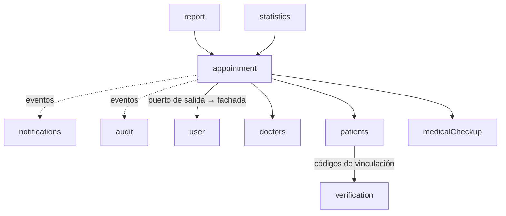

# Manual de código — Backend Piedrazul

Última actualización: 2026-11-20

## 1. Introducción

El backend de Piedrazul es una API REST en Spring Boot 4 y Java 21 que gestiona el agendamiento de citas médicas: médicos y su disponibilidad, pacientes, citas, consultas médicas, notificaciones, auditoría, reportes y estadísticas.

Este manual explica cómo está organizado el código, qué convenciones sigue y cómo extenderlo sin romper la arquitectura. Está dirigido a desarrolladores que se incorporan al proyecto o que necesitan modificar un módulo. Todas las rutas de código son relativas a `backend/src/main/java/co/edu/unicauca/piedrazul/backend/`.

Documentos relacionados en el repositorio: [`CONTRIBUTING.md`](../../CONTRIBUTING.md) (ramas y commits), [`docs/decisions/`](../decisions) (ADR-001 a ADR-007), [`MANEJO_DE_EXCEPCIONES.md`](../development/MANEJO_DE_EXCEPCIONES.md) y [`convenio-migraciones-flyway.md`](../../backend/src/main/resources/db/migration/convenio-migraciones-flyway.md).

## 2. Stack tecnológico

El proyecto se construye con Maven (wrapper `./mvnw`) sobre `spring-boot-starter-parent` 4.0.8 y requiere JDK 21.

| Área | Tecnología | Versión / nota |
| --- | --- | --- |
| Lenguaje | Java | 21 |
| Framework | Spring Boot (Web MVC, Validation, AOP) | 4.0.8 (Tomcat fijado en 11.0.25 por CVE) |
| Modularidad | Spring Modulith (core, eventos JDBC + Jackson) | 2.0.1 |
| Arquitectura | jMolecules DDD / layered + ArchUnit | BOM 2025.0.2 / 1.4.1 |
| Seguridad | Spring Security + OAuth2 Resource Server (JWT) | Emisor: Keycloak |
| Identidad | Keycloak Admin Client | 26.0.8 |
| Persistencia | Spring Data JPA + PostgreSQL | Hibernate en `validate` |
| Migraciones | Flyway (`flyway-database-postgresql`) | `db/migration` |
| Documentación API | springdoc-openapi | 3.0.0, solo perfil `dev` |
| Observabilidad | Actuator + Micrometer Prometheus | puerto de gestión 8081 |
| Reportes | Apache POI, OpenPDF, Commons CSV | 5.4.1 / 1.3.43 / 1.10.0 |
| Correo | Jakarta Mail + Angus Mail (SMTP de Amazon SES) | Resilience4j circuit breaker 2.3.0 |
| Festivos | Jollyday | 0.31.0 |
| Sanitización | jsoup | 1.18.3 |
| Utilidades | Lombok | — |
| Pruebas | JUnit 5, Spring Boot Test, Spring Security Test, Testcontainers PostgreSQL, Modulith Test, ArchUnit | — |

Servicios externos necesarios para ejecutar: PostgreSQL y Keycloak (realm `piedrazul`). El correo (SES) es opcional: deshabilitado por defecto.

## 3. Arquitectura

El backend es un **monolito modular** (ADR-003): una sola aplicación Spring Boot dividida en módulos de negocio cuyos límites declara y verifica Spring Modulith. Dentro de cada módulo se separa el dominio de la infraestructura; el módulo `appointment` aplica arquitectura hexagonal completa (puertos y adaptadores).

### 3.1 Módulos y límites

- Cada paquete de primer nivel bajo `backend/` es un módulo marcado con `@ApplicationModule` en su `package-info.java`.
- `allowedDependencies` lista los módulos o interfaces nombradas (`@NamedInterface`) que el módulo puede usar, por ejemplo `"doctors::api"` o `"shared::enums"`. Depender de otro paquete viola el límite; las pruebas de estructura lo detectan en los módulos que las tienen (ver sección 8).
- Todo lo que no esté en el paquete raíz del módulo ni en una interfaz nombrada es interno.

### 3.2 Comunicación entre módulos

Hay dos mecanismos, y se elige según si quien llama necesita una respuesta:

1. **Llamada síncrona por fachada.** Cada módulo publica una interfaz en su paquete raíz (`DoctorExternalService`, `AppointmentExternalService`, `PatientModuleApi`, `UserModuleApi`, `VerificationModuleApi`, `NotificationModuleApi`, `AuditExternalService`, `MedicalCheckupExternalService`). El módulo consumidor no la llama desde su dominio: define un puerto de salida y lo implementa un adaptador en `infrastructure/integration` (p. ej. `DoctorConfigConsultPortImpl` implementa `DoctorConfigConsultPort` delegando en `DoctorExternalService`).
2. **Eventos de dominio asíncronos.** Un módulo publica eventos desde su paquete `events` (p. ej. `AppointmentScheduledEvent`, `TimeOffChangedEvent`) y otro los consume con `@ApplicationModuleListener`. Los eventos se registran en la tabla de publicaciones de Modulith (JDBC), se archivan al completarse y se republican al reiniciar si quedaron pendientes. `notifications` y `audit` funcionan así.



Las líneas continuas son llamadas por fachada; las discontinuas, eventos. `audit` recibe eventos de todos los módulos. `report` y `statistics` también leen de `doctors` y `patients`, y `verification` envía sus códigos a través de `notifications`; se omiten para que el diagrama se lea de un vistazo.

### 3.3 Capas dentro de un módulo

| Capa | Paquete | Contenido | Puede depender de |
| --- | --- | --- | --- |
| Dominio | `domain/model`, `domain/service`, `domain/port` | Entidades y reglas puras, puertos de entrada (casos de uso) y de salida | Nada de Spring ni JPA |
| Aplicación | `application` | Implementaciones `*UseCaseImpl`, orquestación y transacciones | Dominio |
| Infraestructura | `infrastructure/api`, `persistence`, `integration`, `mappers`, `config`, `automation` | Controladores REST, JPA, adaptadores a otros módulos, mapeadores, beans y tareas programadas | Aplicación y dominio |

Los módulos más simples (`doctors`, `patients`, `user`) usan una variante con `api` (controladores y DTO), `application` (servicios), `domain` e `infrastructure/persistence`.

### 3.4 Transversales

- **Seguridad**: el backend es un OAuth2 Resource Server sin estado; Keycloak emite el JWT y `JwtAuthConverter` convierte `realm_access.roles` en autoridades `ROLE_*` (ADR-001).
- **Errores**: excepciones de negocio que implementan `BusinessException` y se traducen a `ProblemDetail` (RFC 9457) por un `@RestControllerAdvice` por módulo, con `GlobalErrorAdvice` de respaldo.
- **Auditoría**: la anotación `@Auditable` (`shared/audit`) la intercepta un aspecto AOP del módulo `audit`; `CorrelationIdFilter` añade un id de correlación a cada petición y a los logs.
- **Entrada JSON**: el módulo `jackson` normaliza, sanitiza (jsoup) y valida los textos recibidos antes de llegar a los controladores.

## 4. Estructura de paquetes y módulos

El código vive en `co.edu.unicauca.piedrazul.backend` (aplicación, `BackendApplication`) y `co.edu.unicauca.piedrazul.migration` (`SchemaMigrationApplication`, el proceso que aplica las migraciones Flyway en producción).

| Módulo | Responsabilidad | Fachada pública | Depende de |
| --- | --- | --- | --- |
| `appointment` | Agendar, cancelar y listar citas; franjas disponibles; agenda diaria del médico; atención sin cita; agendamiento autónomo; vencimiento automático de citas | `AppointmentExternalService` | doctors, patients, user, medicalCheckup, shared, jackson |
| `doctors` | Médicos, especialidades, horarios laborales por día y ausencias (time-off) | `DoctorExternalService`, `DoctorProvisioningApi` | user, appointment, shared, jackson |
| `patients` | Registro y datos de pacientes, vinculación de cuenta de usuario con código | `PatientModuleApi` | (sin restricción declarada) |
| `user` | Usuarios del sistema y su aprovisionamiento en Keycloak; roles de agendador | `UserModuleApi`, `UserProvisioningApi`, `UserAccountProvisioningApi`, `PersonExternalService` | doctors, patients, config::security, shared, jackson |
| `medicalCheckup` | Historia clínica / consulta médica del paciente | `MedicalCheckupExternalService` | (sin restricción declarada) |
| `notifications` | Plantillas, programación y despacho de notificaciones (correo SES, consola) con reintentos y circuit breaker | `NotificationModuleApi` | appointment::events, appointment::eligibility, shared |
| `verification` | Emisión y validación de códigos de verificación | `VerificationModuleApi` | shared |
| `audit` | Registro de auditoría a partir de eventos y de `@Auditable`; inicios de sesión leídos de Keycloak | `AuditExternalService` | eventos de los demás módulos, shared |
| `report` | Exportación de citas y disponibilidad a CSV, Excel y PDF | — | appointment, doctors, patients, shared |
| `statistics` | Estadísticas de citas por mes, médico, especialidad, cancelación y carga diaria | — | appointment, doctors, shared |
| `shared` | `BusinessException`, manejo base de errores, auditoría compartida, enums (`Role`, `SpecialtyCode`, `Workday`…), paginación, semillas de demo | — | — |
| `jackson` | Anotaciones `@NormalizeName`, `@Sanitize`, `@ValidDocument` para la entrada JSON | — | — |
| `config` | `SecurityConfig`, `JwtAuthConverter`, cliente admin de Keycloak, OpenAPI, CORS, health | — | — |

Estructura típica de un módulo hexagonal (`appointment`):

```text
appointment/
├── AppointmentExternalService.java   # fachada para otros módulos
├── package-info.java                 # @ApplicationModule
├── application/                      # *UseCaseImpl, servicios de orquestación
├── domain/
│   ├── model/                        # Appointment, AppointmentState, ...
│   ├── service/                      # reglas puras (SlotTimeService, BusySlotService)
│   └── port/{input,output}/          # casos de uso y puertos de salida
├── eligibility/                      # interfaz nombrada usada por notifications
├── events/                           # eventos publicados
├── exception/                        # excepciones + AppointmentExceptionHandler
└── infrastructure/
    ├── api/                          # AppointmentController + dto/{input,output,internal}
    ├── automation/                   # tareas programadas
    ├── config/                       # AppointmentConfig (@Bean de casos de uso)
    ├── integration/                  # adaptadores hacia otros módulos
    ├── mappers/
    └── persistence/                  # entidades JPA, repositorios Spring Data, *RepositoryImpl
```

## 5. Convenciones de código

Las reglas siguientes salen del código existente; al agregar código nuevo, imitar al vecino más cercano.

### 5.1 Nombres

| Elemento | Convención | Ejemplo |
| --- | --- | --- |
| Caso de uso (puerto de entrada) | `<Verbo><Objeto>UseCase` en `domain/port/input` | `CancelAppointmentUseCase` |
| Implementación del caso de uso | `<Nombre>UseCaseImpl` en `application` | `CancelAppointmentUseCaseImpl` |
| Puerto de salida | `<Objeto>Repository` o `<Objeto>Port` en `domain/port/output` | `DoctorConfigConsultPort` |
| Adaptador de salida | `<Puerto>Impl` en `infrastructure/persistence` o `integration` | `AppointmentRepositoryImpl` |
| Repositorio Spring Data | `<Entidad>JpaRepository` | `AppointmentJpaRepository` |
| Fachada entre módulos | `<Módulo>ExternalService` o `<Módulo>ModuleApi` en el paquete raíz | `DoctorExternalService` |
| DTO de entrada / salida | `*Request` / `*Response`, en `dto/input`, `dto/output`; los que cruzan módulos, en `dto/internal` | `AppointmentRequest` |
| Evento | `<Hecho en pasado>Event` en `events` | `AppointmentScheduledEvent` |
| Excepción | `<Causa>Exception`, hija de `<Módulo>BusinessException` | `SlotNotAvailableException` |

El código (clases, métodos) está en inglés; los mensajes al usuario, comentarios y Javadoc, en español.

### 5.2 Inyección de dependencias

- Inyección por constructor, con campos `final`. No usar `@Autowired` en campos.
- En `appointment`, las clases `*UseCaseImpl` no llevan `@Service`: se declaran como `@Bean` en `infrastructure/config/AppointmentConfig`. Así el dominio y la aplicación no dependen de anotaciones de Spring.
- Las transacciones (`@Transactional`) van en la capa de aplicación. Para leer y modificar una fila bajo concurrencia se usa bloqueo de fila (p. ej. `findByIdForUpdate`).

### 5.3 DTO y validación de entrada

- Validación con Jakarta Validation (`@NotNull`, `@Pattern`, `@Size`, `@Email`) y **siempre con mensaje explícito** en español: `@NotNull(message = "La fecha es obligatoria")`.
- Anotaciones propias del módulo `jackson`: `@NormalizeName` (nombres de persona), `@Sanitize` (elimina HTML con jsoup), `@ValidDocument(documentField, typeField)` (documento según su tipo).
- Los controladores reciben DTO, nunca entidades JPA ni modelos de dominio; la conversión se hace en `mappers`.

### 5.4 Excepciones y errores

Todo error de negocio es una excepción propia que define código, estado HTTP y módulo:

```java
public class SlotNotAvailableException extends AppointmentBusinessException {
    public SlotNotAvailableException(String message) {
        super(message, "SLOT_CONFLICT", HttpStatus.CONFLICT);
    }
}
```

- `<Módulo>BusinessException` extiende `RuntimeException` e implementa `shared.BusinessException` (`getErrorCode`, `getStatus`, `getModule`).
- El `@RestControllerAdvice` del módulo (`AppointmentExceptionHandler`, `DoctorExceptionHandler`, …) extiende `BaseExceptionHandler` y responde `ProblemDetail` (título, detalle, código, módulo, timestamp).
- El mensaje de una excepción de negocio llega tal cual al usuario: redactarlo para él y sin datos sensibles. Los errores inesperados responden un 500 genérico y se registran sin el texto de la excepción.
- Detalle completo: [`MANEJO_DE_EXCEPCIONES.md`](../development/MANEJO_DE_EXCEPCIONES.md).

### 5.5 Auditoría

Para auditar un endpoint se anota el método del controlador:

```java
@Auditable(action = AuditAction.ROL_ASIGNADO,
           targetEntityType = AuditTargetType.DOCTOR,
           targetIdExpression = "#doctorId",
           onlyDenied = true)
```

`targetIdExpression` es SpEL sobre los parámetros. `onlyDenied = true` registra solo los rechazos por permisos, para no duplicar éxitos que ya audita un evento de dominio.

### 5.6 Ramas y commits

Según [`CONTRIBUTING.md`](../../CONTRIBUTING.md): ramas `<área>/<tipo>/<descripción>` en minúsculas y kebab-case creadas desde `develop` (p. ej. `backend/feature/doctor-time-off`); commits `<emoji> <tipo> (<módulo>): <descripción>`, por ejemplo `♻️ refactor (appointment): verificar con exists si el doctor tiene citas agendadas`.

## 6. API REST y seguridad

Todas las rutas de negocio cuelgan de `/api` y exigen un JWT válido de Keycloak, salvo las públicas listadas abajo. La autorización por rol se declara en cada controlador con `@PreAuthorize`.

### 6.1 Roles

`Role` (`shared/enums`) define `ADMIN`, `SCHEDULER` (agendador), `DOCTOR`, `PATIENT` y `AUDITOR`. `JwtAuthConverter` lee `realm_access.roles` del token y los expone como `ROLE_<rol>`, por lo que en el código se escribe `hasRole('DOCTOR')`.

### 6.2 Controladores

| Ruta base | Controlador | Roles principales | Operaciones |
| --- | --- | --- | --- |
| `/api/appointments` | `AppointmentController` | SCHEDULER, PATIENT, DOCTOR, ADMIN | Listar, agendar, cancelar, atención sin cita, marcar atendida / no asistió, agenda diaria, configuración de agendamiento autónomo |
| `/api/doctor` | `DoctorController` | ADMIN, SCHEDULER, DOCTOR, PATIENT | Perfil propio, especialidades, franjas disponibles, habilitar / deshabilitar médico |
| `/api/doctor/schedules` | `ScheduleController` | ADMIN (consulta: SCHEDULER, PATIENT, DOCTOR) | Horario laboral por día e intervalos disponibles |
| `/api/doctor/time-off` | `DoctorTimeOffController` | ADMIN | Crear, consultar y eliminar ausencias |
| `/api/patients` | `PatientController` | ADMIN, SCHEDULER, DOCTOR, PATIENT | Registro, búsqueda por documento, perfil propio, vinculación de cuenta |
| `/api/user` | `UserController` | ADMIN | Usuarios del sistema, médicos, pacientes, otorgar / revocar rol de agendador |
| `/api/medical-check-up` | `MedicalCheckupController` | DOCTOR | Consultar y actualizar la consulta médica |
| `/api/reports` | `ReportController` | SCHEDULER, DOCTOR | Exportar citas y disponibilidad |
| `/api/statistics` | `StatisticsController` | ADMIN | Estadísticas mensuales, por médico, especialidad, cancelación y carga |
| `/api/audit` | `AuditController`, `AuditFilterCatalogController` | AUDITOR | Consultar el registro de auditoría y sus filtros |

El contrato completo de cada endpoint se consulta en Swagger UI (`/swagger-ui.html`), disponible solo con el perfil `dev`.

### 6.3 Rutas públicas (`SecurityConfig`)

- `GET /actuator/health` y `/error`.
- `GET /api/patients/document/{documento}/public`, `GET /api/patients/document-types`, `GET /api/patients/gender-types`.
- `POST /api/patients/with-user` (autorregistro) y `POST /api/patients/link-user-account/request-code` y `/confirm`.
- Swagger (`/v3/api-docs/**`, `/swagger-ui/**`), que solo existe con el perfil `dev`.

### 6.4 Otras reglas

- Sesión sin estado (`STATELESS`) y CSRF deshabilitado, porque la autenticación es por token.
- Sin token o con token inválido la respuesta es `401` con `{"error":"no autorizado"}`.
- `/actuator/**` exige `ADMIN`; `/actuator/prometheus` solo existe en el puerto de gestión privado (8081).
- CORS: orígenes en `CORS_ALLOWED_ORIGINS` (por defecto `http://localhost:4200`).
- Para agregar una ruta pública hay que tocar `SecurityConfig`; cualquier otra ruta queda autenticada por defecto.

## 7. Persistencia y configuración

Los datos viven en PostgreSQL, esquema `piedrazul`. Flyway es el único que crea o cambia tablas: Hibernate corre en `ddl-auto: validate` y solo comprueba que las entidades coincidan con el esquema.

### 7.1 Patrón de persistencia

1. El dominio define el puerto (`AppointmentRepository`) con modelos de dominio.
2. `infrastructure/persistence/entity` contiene las entidades JPA (`@Entity`).
3. `AppointmentJpaRepository` extiende Spring Data; las consultas de agregación devuelven proyecciones (`MonthlyCountView`, `DoctorDailyCountView`).
4. `AppointmentRepositoryImpl` implementa el puerto y convierte entidad ↔ dominio con los `mappers`.

### 7.2 Migraciones (Flyway)

| Archivo | Contenido |
| --- | --- |
| `V001__baseline_piedrazul_schema.sql` | Esquema base: catálogos (specialty, appointment_state, …), person, patient, doctor, schedule, doctor_time_off, appointment, appointment_config, clinical_history, notification*, verification_code, audit_event, doctor_specialty |
| `V002__baseline_modulith_event_registry.sql` | Tablas de publicación de eventos de Spring Modulith |
| `V003__medical__checkup__adjustment.sql` | Ajustes de la consulta médica |
| `R__seed_catalogs.sql` | Migración repetible con los datos de los catálogos |

Reglas ([`convenio-migraciones-flyway.md`](../../backend/src/main/resources/db/migration/convenio-migraciones-flyway.md)):

- Una migración aplicada **no se edita**; cada cambio es un `V00X__descripcion.sql` nuevo.
- Bloques por tabla con su comentario, columnas, constraints e índices juntos; tablas en orden de dependencia (catálogos, dominio, N:M).
- Nombres de constraints: `pk_<tabla>`, `fk_<tabla>_<ref>`, `uq_<tabla>_<col>`, `ck_<tabla>_<col>`, `idx_<tabla>_<col>`.
- En producción las migraciones las aplica `SchemaMigrationApplication` (servicio `migrate`) con un usuario de migración; el backend corre con `SPRING_FLYWAY_ENABLED=false` y un usuario de aplicación con menos privilegios.

### 7.3 Variables de entorno principales

Todas tienen valor por defecto para desarrollo en `application.yaml`.

| Variable | Uso | Por defecto |
| --- | --- | --- |
| `DB_HOST`, `DB_PORT`, `DB_NAME`, `DB_SCHEMA` | Conexión a PostgreSQL | `localhost`, `5432`, `piedrazul_db`, `piedrazul` |
| `APP_DB_USERNAME`, `APP_DB_PASSWORD` | Usuario de la aplicación | `piedrazul_app` |
| `MIGRATION_DB_USERNAME`, `MIGRATION_DB_PASSWORD` | Usuario de Flyway | `piedrazul_migration` |
| `KC_ISSUER_URI` | Emisor de los JWT | `http://localhost:8180/realms/piedrazul` |
| `KC_SERVER_URL`, `KC_REALM`, `KC_BACKEND_CLIENT_ID`, `KC_BACKEND_CLIENT_SECRET` | Cliente admin de Keycloak | `http://localhost:8180`, `piedrazul`, `piedrazul-backend`, vacío |
| `CORS_ALLOWED_ORIGINS` | Orígenes del frontend | `http://localhost:4200` |
| `APP_TIMEZONE` | Zona horaria del negocio | `America/Bogota` |
| `SPRING_PROFILES_ACTIVE` | `dev` activa Swagger y permite la semilla de demo | sin perfil |
| `APP_DEMO_SEED_ENABLED` | Datos ficticios de demostración (solo con `dev`) | `false` |
| `IDENTITY_SEED_ENABLED` + `IDENTITY_SEED_ADMIN_*` | Crear el primer administrador | `false` |
| `NOTIFICATIONS_SES_ENABLED` + `SES_SMTP_*`, `NOTIFICATIONS_EMAIL_FROM` | Correo por Amazon SES | `false` |
| `NOTIFICATIONS_CONSOLE_SHOW_SENSITIVE` | Mostrar códigos en el log (solo datos sintéticos) | `false` |
| `SERVER_PORT`, `MANAGEMENT_SERVER_PORT` | Puertos de la API y de gestión | `8080`, `8081` |

Las propiedades propias se agrupan bajo `app.*`, `keycloak.*`, `audit.*` y `notifications.*`. Nunca se suben secretos al repositorio.

## 8. Pruebas

El backend tiene 194 clases de prueba en `src/test/java`, con la misma estructura de paquetes que `src/main`. Se separan por sufijo: `*Test` corre con Surefire (`./mvnw test`) y `*IT` con Failsafe (`./mvnw verify`).

| Tipo | Sufijo / herramienta | Qué cubre | Ejemplo |
| --- | --- | --- | --- |
| Unitaria | `*Test`, JUnit 5 + Mockito | Casos de uso y servicios con puertos simulados | `GetAvailableDatesAndSlotsUseCaseImplTest` |
| Controlador | `*WebMvcTest`, Spring Security Test | Rutas, validación, códigos HTTP y roles con `@WithMockUser` / JWT simulado | `DoctorControllerWebMvcTest` |
| Integración | `*IT`, Testcontainers PostgreSQL | Transacciones, bloqueos, consultas e inmutabilidad contra una base real; requiere Docker | `VerificationTransactionalIT`, `AuditEventQueryIT` |
| Estructura | `*ModuleStructureTest`, Spring Modulith | Que el módulo solo dependa de lo que declara | `AppointmentModuleStructureTest` |

Apoyo compartido en `support/`: `PostgresIntegrationSupport` (contenedor PostgreSQL para los `*IT`) y `DiagnosticsProbeEndpoints`.

```bash
cd backend && ./mvnw test              # unitarias y de contexto, sin Docker
cd backend && ./mvnw -B clean verify   # todo, como CI (requiere Docker)
```

Nota: `ApplicationModules.verify()` no se ejecuta sobre toda la aplicación porque hoy falla (`doctors` y `user` declaran la interfaz inexistente `shared :: auth`). Por eso hay pruebas de estructura por módulo (`appointment`, `notifications`, `statistics`).

Regla: todo caso de uso o regla nueva lleva su prueba unitaria; todo endpoint nuevo, su `WebMvcTest` con los roles permitidos y uno rechazado.

## 9. Ejecución y despliegue

En desarrollo, PostgreSQL y Keycloak corren en Docker Compose y el backend en la máquina local con JDK 21. Los comandos parten de la raíz del repositorio.

1. Copiar la plantilla de variables: `cp .env.example .env`.
2. Levantar PostgreSQL y Keycloak y esperar a que `keycloak-dev-secret` termine en `Exited (0)`:

   ```bash
   docker compose up -d --build
   docker compose ps -a keycloak-dev-secret
   ```

3. Exportar las variables (sin `source .env`, que tiene valores con espacios) y arrancar:

   ```bash
   while IFS='=' read -r key value; do export "$key=$value"; done < <(grep -E '^[A-Za-z_][A-Za-z0-9_]*=' .env)
   (cd backend && ./mvnw spring-boot:run)
   ```

4. Comprobar: `curl http://localhost:8080/actuator/health`. Con `SPRING_PROFILES_ACTIVE=dev`, Swagger queda en `http://localhost:8080/swagger-ui.html`.

Con la configuración de desarrollo no hay proveedor de correo, así que pedir un código de verificación responde `503`.

### Imagen Docker

`backend/Dockerfile` tiene dos etapas: compila con `eclipse-temurin:21-jdk-alpine` (`./mvnw package`, hoy con `-Dmaven.test.skip=true`) y ejecuta el JAR en `eclipse-temurin:21-jre-alpine` con usuario no root, puerto 8080, `HEALTHCHECK` sobre `/actuator/health` y `-XX:MaxRAMPercentage=75.0`.

### Producción

El stack se define en `infra/compose/` (`backend.yml`, `migrate.yml`, `prod.yml`, Traefik y observabilidad). El servicio `migrate` aplica Flyway antes del backend, que corre con `SPRING_FLYWAY_ENABLED=false`. Los procedimientos están en `docs/operations/runbooks/` (p. ej. `primer-admin-negocio.md`, `correo-ses.md`).

## 10. Guía para extender: agregar un caso de uso

Ejemplo: un endpoint nuevo en `appointment`. Los pasos siguen el recorrido de una petición desde el dominio hacia afuera.

1. **Puerto de entrada.** Crear `domain/port/input/<Accion>UseCase.java` con un solo método y su Javadoc en español.
2. **Puerto de salida (si hace falta).** Si necesita datos nuevos, agregar el método al puerto existente (`AppointmentRepository`) o crear `domain/port/output/<Objeto>Port.java`. Si los datos son de otro módulo, exponerlos primero en su fachada (p. ej. `DoctorExternalService`) y verificar que el módulo esté en `allowedDependencies` del `package-info.java`.
3. **Adaptador.** Implementar el puerto en `infrastructure/persistence` (consulta Spring Data o proyección) o en `infrastructure/integration` (delegando en la fachada del otro módulo).
4. **Implementación.** Crear `application/<Accion>UseCaseImpl.java` sin anotaciones de Spring, con dependencias por constructor y `@Transactional` si escribe.
5. **Registro del bean.** Declararlo con `@Bean` en `infrastructure/config/AppointmentConfig`.
6. **Errores.** Crear las excepciones como hijas de `AppointmentBusinessException`, con `errorCode` en MAYÚSCULAS y el `HttpStatus` adecuado; el `AppointmentExceptionHandler` las traduce sin cambios.
7. **DTO.** Request en `infrastructure/api/dto/input` con validaciones y mensajes; response en `dto/output`; mapeo en `mappers`.
8. **Endpoint.** Agregar el método en `AppointmentController` con `@PreAuthorize` por rol y, si es una acción sensible, `@Auditable`.
9. **Base de datos.** Si cambia el esquema, nueva migración `V00X__descripcion.sql` siguiendo el convenio; nunca editar una aplicada.
10. **Eventos.** Si otro módulo debe reaccionar (notificar, auditar), publicar un evento en `events` en lugar de llamarlo directamente.
11. **Pruebas.** Unitaria del `UseCaseImpl` con puertos simulados, `WebMvcTest` del endpoint y, si toca SQL o concurrencia, un `*IT` con Testcontainers. Ejecutar `./mvnw -B clean verify` antes del PR.

Lista de revisión antes del PR:

- [ ] El dominio no importa nada de Spring, JPA ni de otro módulo.
- [ ] Las dependencias nuevas entre módulos están en `allowedDependencies`.
- [ ] Cada validación y excepción tiene mensaje en español para el usuario, sin datos sensibles.
- [ ] El endpoint tiene `@PreAuthorize` y prueba de rol rechazado.
- [ ] Rama y commits siguen `CONTRIBUTING.md`.
